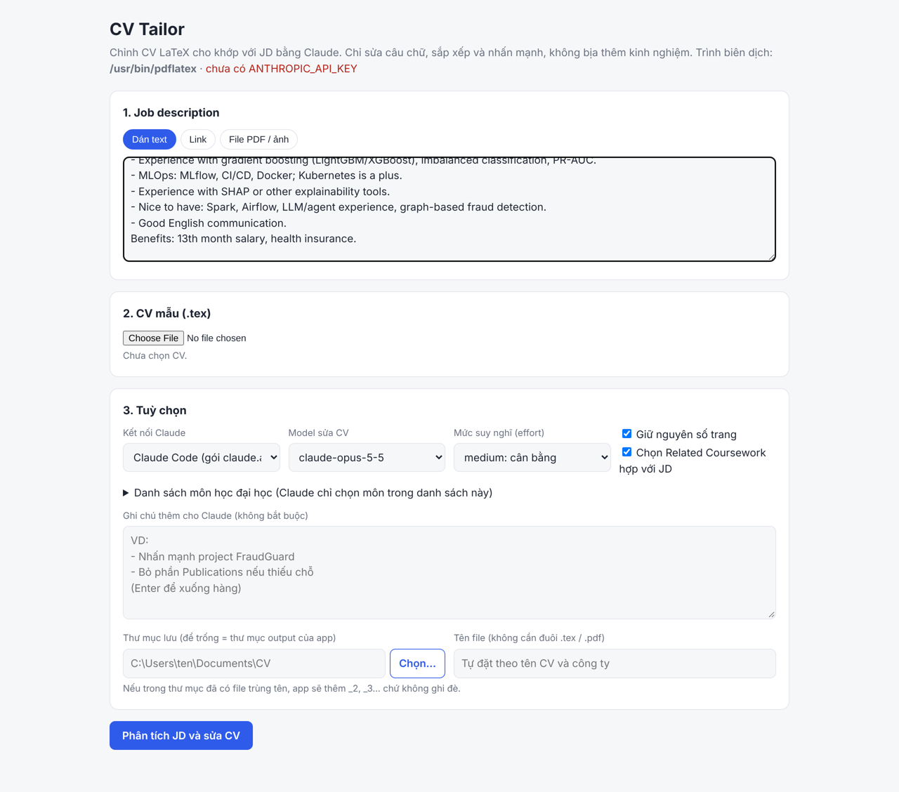

# CV Tailor

A small web app that runs on your own computer and uses Claude to tailor a LaTeX CV to a specific job description (JD). Give it a job post and your `.tex` CV, and in about 30 seconds you get a tailored `.tex` file and a compiled PDF.



*The interface is in Vietnamese. A full Vietnamese guide is in [README.vi.md](README.vi.md).*

## What it does

- **Job description input:** paste text, paste a public link, upload a PDF, or upload a screenshot (you can also paste an image straight into the page with Ctrl+V).
- **CV input:** your LaTeX `.tex` CV. The app remembers the last CV in your browser.
- **Output:** a tailored `.tex` and a compiled `.pdf`, previewed on the page and ready to download. You choose the output folder and file name. Existing files are never overwritten; the app adds `_2`, `_3`, and so on. Every run is also saved in `output/<time>_<company>/` with a `report.json` that lists every change.
- **No invented content:** Claude may only reword the CV in the JD's terms, reorder, emphasise, or trim. It never adds experience, numbers, or skills you don't have. JD requirements your CV does not cover are listed separately so you can decide what to do.
- **Before / after view:** every edited passage is shown side by side, so you can check the changes quickly.
- **Related coursework:** keep a list of all your university courses in `courses.md` (editable on the page). When enabled, Claude picks the 3 to 6 courses that best fit the JD, only from that list, and keeps each course under the right university.
- **Re-run without re-reading the JD:** after a JD is analysed, you can run again with a different model, effort level, or note, without paying for JD analysis again.

## How it keeps token cost low

| Step | What happens | Why it is cheap |
|---|---|---|
| 1. Read the JD | Links and PDFs are converted to text locally (BeautifulSoup, pypdf). Only images and scanned PDFs are sent as files. | No tokens spent on HTML, menus, or footers. |
| 2. Summarise the JD | A small, cheap model turns the JD into a short list of requirements (JSON). The result is cached on disk by hash, so the same JD costs 0 tokens the next time. | The main model reads a few hundred tokens instead of the full post. |
| 3. Send the CV | Only the CV body is sent, split by section, without comments. The LaTeX preamble stays on your machine; only `\newcommand` lines are sent so the model understands your macros. | Nothing that doesn't need editing is sent. |
| 4. Prompt caching | The fixed system prompt and the CV block are marked with `cache_control`. Tailoring the same CV for several JDs in a row reads the CV from cache. | Repeated parts cost a fraction of the normal price. |
| 5. Return edits only | The model returns structured JSON with only `old → new` edits instead of rewriting the file. The app applies the edits and puts the preamble back. | Output tokens are the most expensive, and now there are only a few hundred. |
| 6. Fix only when needed | If compiling fails, only the changed section and a short error log are sent back. If the CV gains a page, the model is asked once to shorten it. | Extra tokens are spent only when something actually goes wrong. |

A cost table at the bottom of each result shows the tokens and estimated cost of every step, including cache reads and writes.

## Setup

You need:

1. **Python 3.10+**
2. **A LaTeX compiler**, one of:
   - [Tectonic](https://tectonic-typesetting.github.io/) (smallest; downloads packages on demand).
   - TeX Live, MacTeX, or MiKTeX with `pdflatex` (or `latexmk`). On Ubuntu: `sudo apt install texlive-latex-extra texlive-fonts-recommended lmodern`.

   The app looks for tectonic, then latexmk, then pdflatex, and uses xelatex if your CV loads `fontspec`.
3. **One way to connect to Claude** (chosen on the page):
   - **Claude Code with a claude.ai Pro/Max plan, at no extra cost.** Install Node.js 18+, run `npm install -g @anthropic-ai/claude-code`, then run `claude` once to sign in. The app calls `claude -p` with its own system prompt and tools turned off, so it uses little of your plan's quota.
   - **An Anthropic API key, paid per token.** Create a key at https://console.anthropic.com and put it in `.env`.

## Run

macOS / Linux:

```bash
cd cv-tailor
cp .env.example .env      # only needed for an API key
./run.sh
```

Windows (Command Prompt):

```bat
cd cv-tailor
run.bat
```

The script creates a Python environment, installs the requirements, reads `.env` if present, and opens http://127.0.0.1:8000 in your browser. Choose a JD and a CV, then press the main button to analyse the JD and tailor the CV.

### Using it from another device

The app can also be opened from a phone or another laptop on the same Wi-Fi. Set `CV_TAILOR_HOST=0.0.0.0` and a `CV_TAILOR_PASSWORD` in `.env` (the app refuses to start without a password in this mode), then open `http://<your-computer-ip>:8000`. For access outside your home network, use a private network such as Tailscale rather than opening a port to the internet.

## Configuration

All settings are optional and go in `.env` (see `.env.example`):

| Variable | Meaning |
|---|---|
| `ANTHROPIC_API_KEY` | Needed only for the API backend. |
| `CV_TAILOR_BACKEND` | `api` or `claude-code`. Default: `api` if a key is set, otherwise `claude-code`. |
| `CV_TAILOR_MODEL` | Model used to edit the CV. |
| `CV_TAILOR_EXTRACT_MODEL` | Cheaper model used to summarise the JD. |
| `CV_TAILOR_OUTPUT` | Default output folder. |
| `CV_TAILOR_HOST`, `CV_TAILOR_PORT`, `CV_TAILOR_PASSWORD` | Network access from other devices. |

## Project structure

```
cv-tailor/
├── app/
│   ├── main.py        # FastAPI app: /api/jd, /api/tailor, downloads
│   ├── jd_input.py    # read a JD from text, a link, or a PDF
│   ├── llm.py         # call Claude (API or Claude Code): summarise JD, edit CV, fix errors
│   ├── latex.py       # split sections, apply edits, compile the PDF
│   └── static/index.html
├── tests/             # python -m pytest tests (no API key needed)
├── output/            # results of each run
└── data/jd_cache/     # cached JD summaries
```

## Tests

```bash
pip install -r requirements.txt pytest
python -m pytest tests
```

The tests mock the model, so they run without an API key or a Claude account. They cover LaTeX section parsing, applying edits, the full tailoring flow, the Claude Code backend, saving and recompiling, password protection, and coursework selection.

## Notes

- Sections are detected from `\section`, `\cvsection`, and any custom macro with "sec" in its name (for example `\secname`). With other templates the CV still works but is treated as one block.
- Pages that need a login or load content with JavaScript (LinkedIn, some job boards) cannot be read from a link; paste the text or a screenshot instead.
- Always read the tailored CV before you send it.
